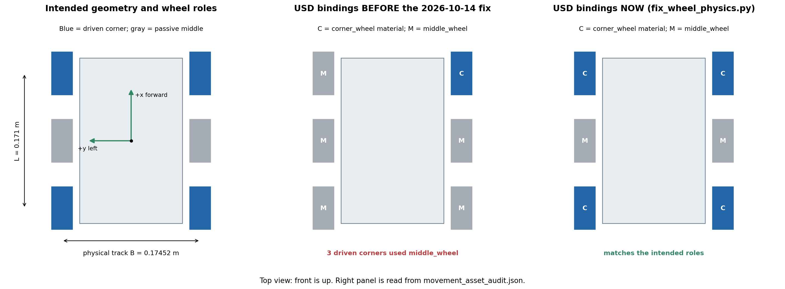
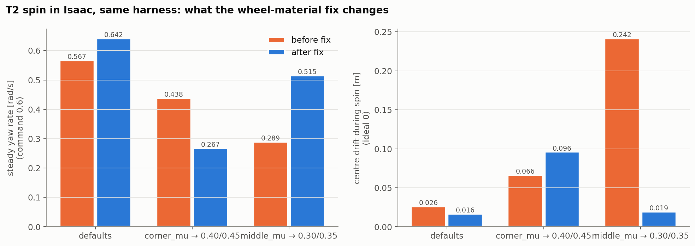
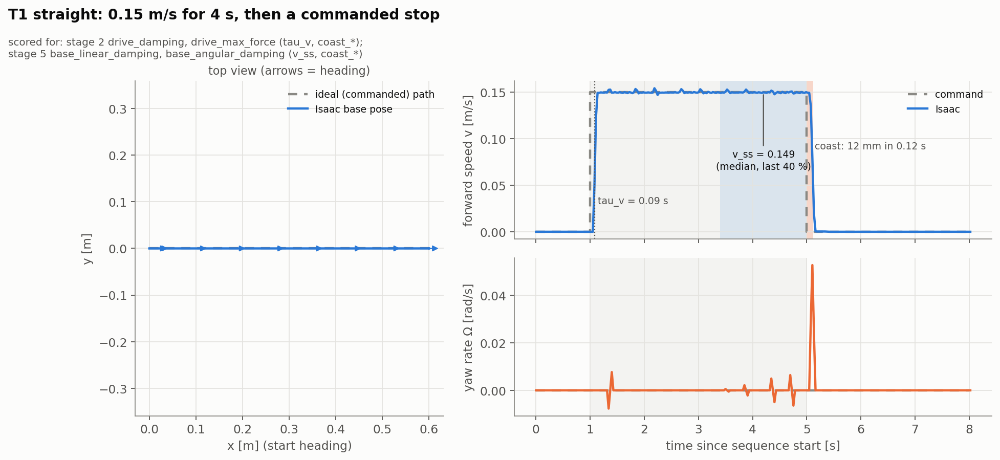
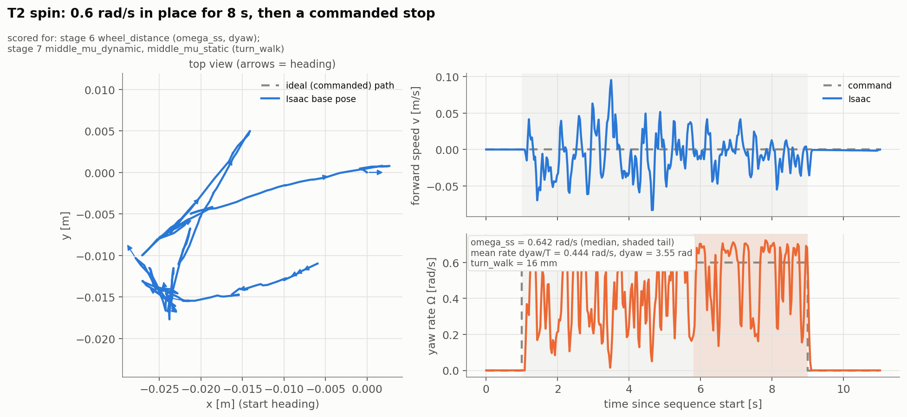
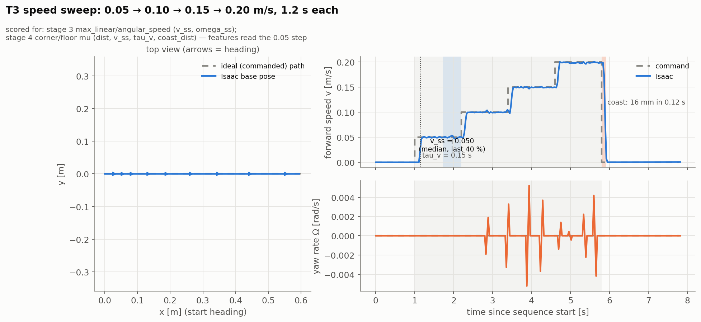
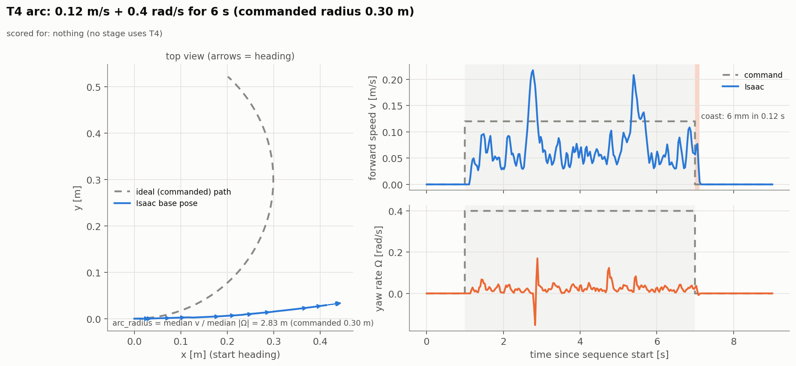
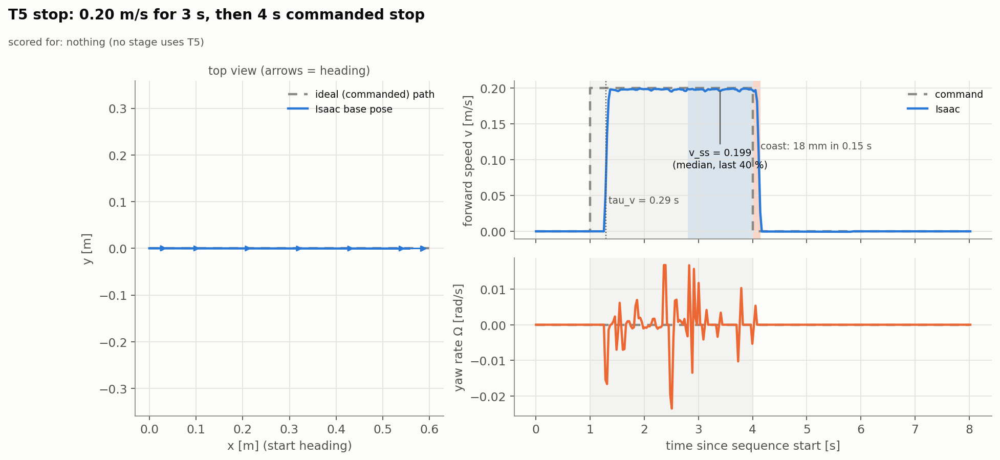
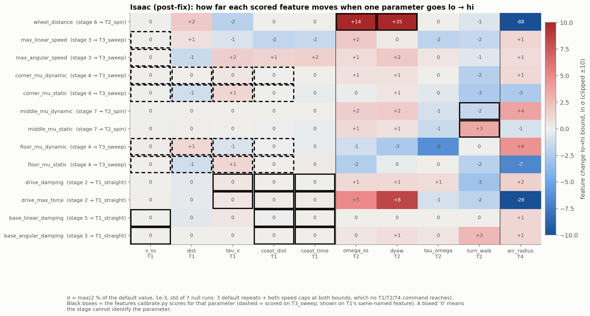
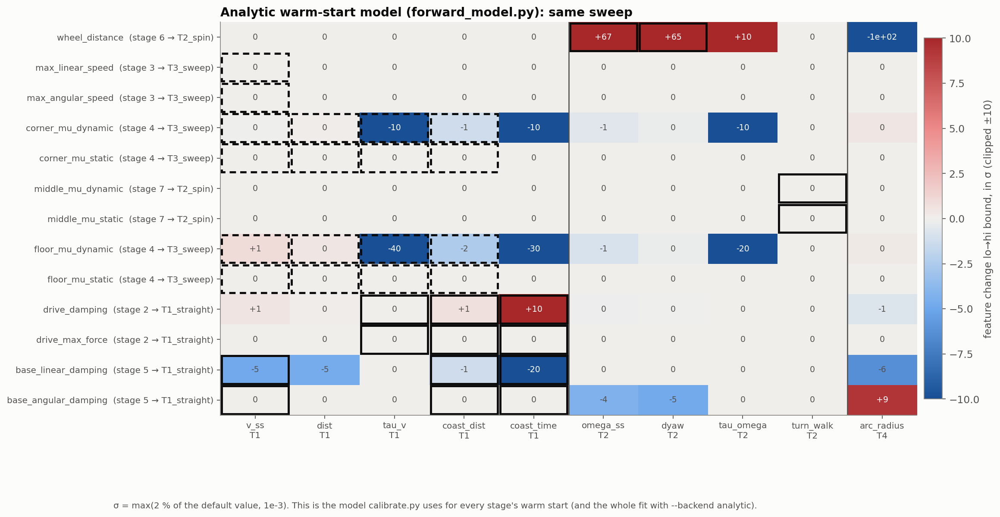

# Parameter ↔ test validation and the 2026-10-14 wheel fix

**Current optimizer update (2026-10-15):** wheel static/dynamic friction for both materials,
drive damping, and linear/angular chassis damping have been restored to the Isaac search.
The freeze recommendations and stage table below describe the earlier sensitivity study,
not the current parameter availability. See [the current parameter/test map](../optimize/README.md#searchable-parameters-and-tests)
and `ugv_controller_v2/calibration/calib_params.py` for the active bounds and stages.

This document checks two claims made in [ROVER_MOVEMENT_EXPLAINED.md](ROVER_MOVEMENT_EXPLAINED.md) against the USD and against **real Isaac trials**:

1. the simulated wheels were mis-assigned (wrong friction materials) and possibly wrong in other ways;
2. some calibration parameters are attached to tests that cannot move them.

For every one of the 16 parameters, it then lists the test motion it is scored on, the equation linking it to the scored feature, and what the measurements say. Suggested changes are listed at the end; none of them are implemented.

Evidence in this document comes from four sources:

| Source | What it is |
|---|---|
| USD inspection | Composed `jetson_rover_v2.usd` read with Isaac's `pxr` (bindings, mass, inertia, colliders, joints) |
| Isaac before/after | `optimize/sim_eval.py` trials (headless Isaac, baked ROS graph, `/cmd_vel` → `/ugv_sim/odom`), run before and after the fix with identical harness settings |
| Isaac sensitivity sweep | `95` trials after the fix: each of the 13 optimisable parameters at its lower and upper bound on T1/T2/T4, three repeats of the defaults, and probes beyond the drivetrain bounds |
| Analytic sweep | The same sweep on `optimize/forward_model.py`, the model `calibrate.py` uses for every warm start |

All trials use `combine_mode=min` and the schema defaults (`calib_params.defaults()`), which is what `calibrate.py` runs. Raw results are in [`param_validation/`](param_validation/), and the figures are regenerated by [`build_param_validation.py`](build_param_validation.py).

---

## 1. Verdicts on the earlier claims

| Claim | Verdict | Evidence |
|---|---|---|
| Three driven corner wheels used the `middle_wheel` material | **Confirmed and fixed** | Five collider prims carried `material:binding:physics → middle_wheel`, including `left_up`, `left_down` and `right_down`. Only `right_up` resolved to `corner_wheel`. The same bug is in the committed HEAD version. |
| …so `middle_mu_*` mostly tuned driven wheels | **Confirmed in Isaac** | Before the fix, lowering `middle_mu` to 0.30/0.35 cut the spin rate from 0.567 to 0.289 rad/s and made the chassis drift **242 mm** during an in-place spin. Lowering `corner_mu` (one wheel) changed less. After the fix the roles swap (§2). |
| Other wheel problems | **One more confirmed and fixed; one new and unresolved** | Wheel inertia was about 2.6× too large and physically impossible (§2.2), now fixed. Arcs fail in Isaac (§2.4); I diagnosed this but could not fix it. |
| Analytic model ignores static friction and middle-wheel friction | **Confirmed** | `forward_model.py` reads only `corner_mu_dynamic` and `floor_mu_dynamic`. Sweeping either static coefficient or either middle coefficient over its full bounds moves no analytic feature at all. `calibrate.py --self-test` misses `floor_mu_static` by 44–186 %. |
| Centered spin always predicts zero translation, so `turn_walk` can't identify anything analytically | **Confirmed** | The analytic `turn_walk` is exactly 0 for every θ. |
| Straight-only test can't identify angular damping | **Confirmed** | `base_angular_damping` is scored on T1; T1 has no yaw motion, so it gives 0σ (analytic) and noise only (Isaac). |
| T3 tops out at 0.20 m/s, below the 0.5 m/s cap | **Confirmed, and worse** | All four T3 steps last 1.2 s, so `features.py`'s "longest straight" takes the **first**, the 0.05 m/s step. Isaac T3 reports `v_ss = 0.050`. Also, `max_linear_speed`'s lower bound is 0.2, so no T3 step can ever be clamped. |
| Arc and stop tests aren't scored | **Confirmed** | `calibrate.STAGES` uses only T1, T2 and T3. |
| `wheelRadius` YAML comment gives the wrong tuning direction | **Confirmed** | Sim speed is r_phys/R·v_c, so raising R *slows* the sim. The comment in `sim_calibration.yaml` says to raise R if the real rover goes farther. Not edited (see §6). |
| Real driver raises pure-spin commands below 0.2 rad/s | **Confirmed** | `ugv_driver.py:47-51` |
| *(new)* Drivetrain stage 2 can't identify either of its parameters | **New finding** | §4.2. On T1 both knobs are invisible across their full bounds: the drive is an ideal velocity lock and traction sets the ramp. `drive_max_force` does matter, but for **turning** (spin stalls at 0.05 N·m). |
| *(new)* Analytic servo is numerically unstable | **New finding** | Explicit Euler with gain·dt/m_eff ≈ 500–99 000 (stable needs < 2). The analytic T1 speed chatters 0.11–0.19 m/s around a 0.15 command, held in check only by the force clamp. |
| *(new)* Missing `floor_friction` silently changes contact friction | **New finding** | `sim_eval` always passes `--combine-mode`, so `author_floor()` binds a floor material even when no friction values are given. Its friction is then unauthored, with a UsdPhysics fallback of 0. An Isaac T1 with `calib={}` reached `v_ss` 0.096 (vs 0.149) and coasted 1.08 s (vs 0.12 s), consistent with μ_eff ≈ 0.01. |

---

## 2. What was wrong with the simulated wheels, and what changed

Fixed by **[`ugv_controller_v2/tools/fix_wheel_physics.py`](../../ugv_controller_v2/tools/fix_wheel_physics.py)**, run through `fix_wheel_physics.sh`. The tool is idempotent: a second run reports "Nothing to change". The pre-fix USD is saved as `jetson_rover_v2.usd.bak-20261014-224227-wheels`.

### 2.1 Friction material bindings



Each wheel collider `<wheel>_link/collisions/<mesh>/node_STL_BINARY_` had its own physics-purpose binding. That binding beats the `collisions` Xform's all-purpose binding, which *was* correct. The tool rebinds the colliders by drive role:

| Wheel | Role | Before | After |
|---|---|---|---|
| left_up / left_down / right_down | driven | `middle_wheel` | `corner_wheel` |
| right_up | driven | `corner_wheel` | `corner_wheel` |
| left_middle / right_middle | passive | `middle_wheel` | `middle_wheel` |

### 2.2 Wheel inertia was impossible

The URDF (CAD export) gives each wheel **0.2071 kg** and the inertia of a uniform hollow cylinder of that mass:

$$
I_{spin}=\tfrac12 m (r_o^2+r_i^2)=\tfrac12(0.2071)(0.04^2+0.007^2)=1.707\times10^{-4}\ \mathrm{kg\,m^2}
$$

The USD later overrode the mass to **0.08 kg** but kept the inertia. That gives $I_{spin} > m r_o^2 = 1.28\times10^{-4}$, which no wheel of radius 4 cm can have. Every wheel's spin inertia also reflects into the chassis as translational mass $6 I/r^2$, so this added **0.64 kg** of phantom mass to a 2.19 kg rover. The tool measures $r_o, r_i, w$ from the collision mesh (0.0400, 0.0070, 0.0425 m) and authors the same cylinder at the authored mass:

$$
I_{spin}=6.60\times10^{-5},\qquad I_{trans}=\tfrac1{12}m\,[3(r_o^2+r_i^2)+w^2]=4.50\times10^{-5}\ \mathrm{kg\,m^2}
$$

The reflected mass is now 0.25 kg, giving m_eff = 2.44 kg (was 2.83). `forward_model.I_WHEEL` was updated to match. **If `wheel_mass` is ever changed, re-run the tool**: `calib_params` authors mass only.

### 2.3 What the fix changes in Isaac (same harness, T2 spin)



| Isaac trial | omega_ss before → after [rad/s] | turn_walk before → after [mm] |
|---|---|---|
| defaults (spin cmd 0.6 rad/s) | 0.567 → 0.642 | 26 → 16 |
| `corner_mu` → 0.40/0.45 | 0.438 → **0.267** | 67 → 96 |
| `middle_mu` → 0.30/0.35 | **0.289** → 0.516 | **242** → 19 |

Before the fix, the "middle" knob was the dominant drive-traction knob, and its asymmetric left/right effect made spins walk. After the fix, `corner_mu` governs the driven tires as named, and `middle_mu` is a secondary effect. Straight-line behavior barely changed (T1 `v_ss` 0.1498 → 0.1494). **Any calibration fitted before 2026-10-14**, including the `live` spin fit of `wheel_distance` ≈ 0.304, was fitted to the broken wheels and should be re-run.

### 2.4 Unresolved: the simulated rover cannot turn while driving forward

T4 (0.12 m/s with 0.4 rad/s, commanded radius 0.30 m) produced a **2.4–2.8 m** radius after the fix (1.39 m before). The rover reaches only ~0.06 m/s and ~0.02 rad/s, about 5 % of the commanded yaw rate, with jerky speed spikes. A gentle arc (0.15 m/s with 0.15 rad/s) achieved 4 % of its yaw command. A pure spin achieves 107 %.

What I ruled out (each a separate Isaac T4 trial; raw results in `param_validation/arc_probes.json`):

| Probe | Arc yaw rate [rad/s] (cmd 0.4) |
|---|---|
| defaults | 0.024 |
| bypass ROS / controller (`mode="direct"`, wheel speeds set directly) | 0.019 |
| `wheel_distance` = physical track 0.1745 | 0.005 |
| finite motor torque `drive_max_force` = 0.15 N·m | 0.006 |
| floor μ 0.4 / 0.45 | 0.026 |
| static μ = dynamic μ (no stiction gap) | 0.022 |
| middle-wheel μ 0.05, or middle-wheel colliders disabled | 0.034 / 0.041 |
| compliant wheel contact (stiffness 3000, damping 30) | 0.041 |
| scene friction correlation distance 0.1 m, offset threshold 1 mm | 0.024 / 0.022 |
| articulation velocity iterations 4 → 16 | 0.025 |
| scene friction type `twoDirectional` / `oneDirectional` | 0.024 / 0.024 |
| perfect-sphere wheel colliders | 0.0002 |

An independent planar model (6 rigid wheels, isotropic Coulomb friction μN opposing each contact's slip, 4 velocity-locked driven wheels, 2 free-rolling wheels, `/tmp` script reproduced in §7) turns **as efficiently in arcs as in spins**: 146 % of the commanded yaw in both cases at D = 0.5. So the arc collapse is not inherent skid-steer physics, and it is not any single wheel parameter or PhysX contact setting above. I left it unfixed rather than ship a speculative contact-model change that can't be validated without real arc data. §6 gives the next diagnostic steps. **Nav2 commands arcs constantly, so this likely matters more for nav experiments than any of the 16 parameters.**

### 2.5 Checked and found acceptable or not changed

* **Collider shape.** Each wheel is a 38-sided hollow prism (r_o 0.040, r_i 0.007, w 0.0425). It is cooked as `convexHull` under PhysX's default 64-vertex limit, while the rim has 76 vertices, so a few vertices may be dropped (worst case about 0.5 mm of rolling ripple). The cooked hull can't be queried for these Xform-hosted colliders, and GPU-compatible cooking caps hulls at 64 anyway, so this is unchanged.
* **Middle-wheel colliders.** These reference the `*_up_wheel_link` mesh, which is identical geometry. Only the name is odd.
* **Ground clearance.** Wheels sit 8.9 mm above z=0 in the authored pose and settle on contact. The base link has no collider.
* **Joints.** Passive middle joints have `maxForce 0` and `damping 0`: free-rolling, as intended. Driven joints are velocity drives (stiffness 0).
* **URDF.** `ugv_rover_isaac_fixed.urdf` has a stray duplicate `</collision>` after `left_up_wheel_link`. It's not used by the v2 USD and is uncommitted user work, so it is not edited.

---

## 3. The five tests: commanded motion, measured motion, extracted features

Every feature is computed by `optimize/features.py` identically for real, Isaac and analytic tracks $(t,x,y,\psi)$, with

$$
v_k=\frac{\lVert \Delta p_k\rVert}{\Delta t_k},\qquad \Omega_k=\frac{\Delta\,\mathrm{unwrap}(\psi)_k}{\Delta t_k}
$$

| Feature | Definition (window) |
|---|---|
| `v_ss` | median $v$ over the last 40 % of the **longest** straight step (ties → the first) |
| `dist` | path length over that step |
| `tau_v` | time from that step's *commanded* start until $v \ge 0.632\,v_{ss}$ |
| `coast_time`, `coast_dist` | from the first zero step after a straight/arc, until $v<0.02$ m/s |
| `omega_ss` | median $\lvert\Omega\rvert$ over the last 40 % of the longest spin |
| `dyaw` | $\lvert\psi_{end}-\psi_{start}\rvert$ over the spin |
| `tau_omega` | time until $\lvert\Omega\rvert\ge0.632\,\omega_{ss}$ |
| `turn_walk` | $\lVert p_{end}-p_{start}\rVert$ over the spin |
| `arc_radius` | median $v$ / median $\lvert\Omega\rvert$ over the first arc |

Two measurement facts apply to all of them:

* **Timing features include command latency.** `tau_v` and `coast_*` start at the *commanded* step time, so any command-to-wheel delay $t_{lat}$ adds directly. Three identical Isaac default runs gave `coast_time` 0.12/0.38/0.12 s and `coast_dist` 11/48/12 mm, from wall-clock ROS timing alone. The real rover has its own (ESP32 serial) latency.
* **Odometry rate.** In ROS mode the Isaac odom arrives at about 34 Hz (Δt ≈ 29 ms), so `tau_*` is quantized to multiples of about 29 ms.

Each figure below is a **real post-fix Isaac trace at default parameters**. Left: top view (ideal commanded path dashed). Right: commanded vs measured forward speed and yaw rate, with the feature windows shaded.

### T1 straight — `0.15 m/s × 4 s → stop`



Commanded kinematics: $\dot x=v$, $\dot\psi=0$. Ideal $v_{ss}=0.15$, ideal distance 0.60 m. Physics, with traction-limited acceleration and active braking (§4.2):

$$
v_{ss}\simeq \frac{r}{R}\min(v_c, v_{max}),\qquad
\tau_v\simeq t_{lat}+\frac{0.632\,v_{ss}}{a_{max}},\qquad
d_{coast}\simeq v_0\,t_{lat}+\frac{v_0^2}{2a_{brake}}
$$

$$
a_{max}\approx a_{brake}\approx\frac{\min\!\big(4\tau_{max}/r,\ \mu_{eff}N_d\big)}{m_{eff}} = \frac{0.75\times14.3\ \mathrm{N}}{2.44\ \mathrm{kg}} = 4.4\ \mathrm{m/s^2}
$$

So the physics part of `tau_v` is 22 ms and of the stop is 34 ms / 2.6 mm. Everything above that in the measured 0.09–0.38 s / 11–48 mm is latency and sampling.

### T2 spin — `0.6 rad/s × 8 s → stop`



Commanded kinematics: $\dot x=\dot y=0$, $\dot\psi=0.6$. Wheel targets are $\pm D\,\Omega_c/(2R)=\pm3.75$ rad/s. Each wheel center moves sideways at $w_i=\Omega x_i$ (corners ±0.0855 m, middles 0), so the corners must scrub laterally:

$$
\Omega_{ss}=\frac{r}{R}\,\frac{D}{\chi B}\,\Omega_c,\qquad \chi_{Isaac,post\text{-}fix}=\frac{0.5/0.1745}{0.647/0.6}=2.66
$$

$\chi$ (scrub inefficiency) depends on $L/B = 0.98$, the friction coefficients and the load distribution. `turn_walk` is 0 for a left/right-symmetric rover and grows with asymmetry in friction, load or COM. The three identical default runs gave 27 / 7 / 27 mm, so it is noise-dominated in sim; real recordings showed 35–39 mm.

### T3 speed sweep — `0.05 → 0.10 → 0.15 → 0.20 m/s, 1.2 s each`



Designed to show a speed-response curve $v_{ss}(v_c)$ ("flat plateau ⇒ clamp, soft shoulder ⇒ μ/torque/drag"), but `features.py` extracts **one** `v_ss`, from the first step (0.05 m/s). The coast window follows the 0.20 step.

### T4 arc — `0.12 m/s + 0.4 rad/s × 6 s → stop` (unscored)



Commanded radius $\rho=v_c/\Omega_c=0.30$ m. Wheel targets are $(v_c\mp D\Omega_c/2)/R$ = 0.5 rad/s (inner) and 5.5 rad/s (outer). Under the lumped model, $\rho\approx \frac{v_c}{\Omega_c}\frac{\chi B}{D}$. Isaac gives 2.4–2.8 m (§2.4).

### T5 stop — `0.20 m/s × 3 s → 4 s stop` (unscored)



The same coast physics as T1 from a higher speed: $d_{coast}=v_0 t_{lat}+v_0^2/2a_{brake}$, 4.5 mm of physics plus about 20 mm per 100 ms of latency.

---

## 4. Every parameter: which test, what motion it changes, the equation, and whether it is identifiable

### 4.1 How the assignments look in the data





Each cell is the change of one feature when one parameter moves from its lower to its upper bound, in units of σ. Here σ = max(2 % of the default value, 1e-3, the std of 7 null Isaac runs: 3 default repeats plus both speed caps at both bounds, which no T1/T2/T4 command reaches). **Black boxes are the features `calibrate.py` actually scores for that parameter.** A boxed cell near 0 means that stage cannot identify its parameter. A large unboxed value means the parameter moves a feature that is not used to fit it. Values are in `param_validation/sensitivity_{isaac,analytic}.csv`.

How to read it: each cell compares **one** lo run with **one** hi run, so its own noise is about √2 σ ≈ 1.4σ. Treat |Δ| < 3σ as noise. The noise is real and large. In 7 null runs (parameters that provably can't act), the sim scattered by 55 % of the mean on `coast_time`, 66 % on `coast_dist`, 38 % on `tau_v` and 55 % on `turn_walk`, but only 7 % on `dyaw`, 5 % on `arc_radius` and 2 % on `v_ss`. This comes from ROS command timing (the sim ran a handful of discrete outcomes: several different parameter settings produced bit-identical traces) and from stick-slip during spins. `targets/example_heavy_carpet.yaml` assumes σ ≈ 2–3 % on all of these, so as written the optimizer would be fitting noise on every timing feature.

What the Isaac matrix says:

* **Only `wheel_distance` is identified by the features it is scored on** (`omega_ss` +14σ, `dyaw` +35σ). Every other boxed cell is within noise, except `middle_mu_static` → `turn_walk` at +3.4σ, which is borderline and has the opposite sign to `middle_mu_dynamic`.
* **T1 straight identifies none of the 13 optimizable parameters.** `v_ss` was 0.149 m/s in all 95 runs except the 0.02 N·m stall probe. The stiff wheel servo delivers the commanded wheel speed whatever the friction, drag or gain. T1's timing features (`tau_v`, `coast_*`) measure command latency, not drivetrain physics (§3).
* **The physics shows up when turning.** T2/T4 respond to `drive_max_force` (`dyaw` +8σ, `arc_radius` −28σ), `floor_mu_dynamic` (`tau_omega` −6σ, `arc_radius` +4.5σ), `floor_mu_static` (`arc_radius` −6.8σ) and `middle_mu_dynamic` (`arc_radius` +3.7σ). Scrub is where friction and torque limits bind.
* **The analytic warm-start model disagrees with Isaac exactly where it matters.** It predicts large T1 effects for `floor/corner_mu_dynamic` (`tau_v` −10…−40σ), `base_linear_damping` (`coast_time` −20σ) and `drive_damping` (`coast_time` +10σ, a numerical artifact). Isaac shows none of these. It predicts nothing for the static and middle coefficients, which Isaac does respond to. Its warm start therefore pushes stages 2, 4 and 5 toward values chosen by model artifacts.

### 4.2 Parameter cards

Notation: $v_c,\Omega_c$ command; $r=0.04$ physical radius; $B=0.1745$ track; $L=0.171$ wheelbase; $m=2.19$ kg; $m_{eff}=2.44$ kg; $N_d\approx\frac46 mg=14.3$ N on the driven wheels; Isaac numbers use `combine_mode=min`, so $\mu_{eff}=\min(\mu_{wheel},\mu_{floor})$.

Each card gives: **USD target · default · bounds**; **scored on** (from `calibrate.STAGES`); **motion it changes**; **equation**; **measured** (Isaac lo→hi raw values, σ-normalized effect; analytic effect); **verdict**.

#### `wheel_radius` (R) — frozen
* `DiffController.inputs:wheelRadius` · 0.04 m · frozen (no bounds) · not scored.
* **Motion:** scales every wheel-speed target, so it scales forward speed and yaw rate together.
* **Equation:** $\dot q^*=\bar v/R \Rightarrow v_{ss}=\frac{r}{R}\bar v,\ \Omega_{ss}=\frac rR\frac{D}{\chi B}\bar\Omega$. It is a conversion gain, not the tire size: raising R **slows** the sim.
* **Measured:** Isaac T1 `v_ss` = 0.1493 for a 0.15 command, so r/R = 0.995.
* **Verdict:** correctly frozen if the real rover's T1 `v_ss`/v_c ≈ 1. If it isn't, R is the **only** schema knob that can move straight-line speed: nothing else moved T1 `v_ss` by even 0.2σ. The `sim_calibration.yaml` comment states the wrong tuning direction.

#### `wheel_distance` (D)
* `DiffController.inputs:wheelDistance` · 0.5 m · [0.25, 0.9] · **stage 6, T2 spin: `dyaw`, `omega_ss`**.
* **Motion:** the left/right wheel-speed difference per unit yaw command. That gives the spin rate in T2 and the curvature in T4.
* **Equation:** $\dot q^*_{R,L}=(\bar v\pm D\bar\Omega/2)/R$, $\ \Omega_{ss}=\frac rR\frac{D}{\chi B}\Omega_c$, $\ \rho\approx\frac{v_c}{\Omega_c}\frac{\chi B}{D}$.
* **Measured:** T2 `omega_ss` 0.10 → 1.31 rad/s (+14σ), `dyaw` 0.89 → 9.62 rad (+35σ). T4 `arc_radius` **12.6 → 0.13 m** (−88σ). Analytic agrees in sign.
* **Verdict:** **correctly attached and well identified on spins**. But the arc response is extremely nonlinear (at the default 0.5, a 0.30 m commanded arc drives 2.7 m), so a spin-only fit says nothing about arcs. **Score it on T2 and T4 jointly.**

#### `max_linear_speed`, `max_angular_speed`
* `DiffController.inputs:maxLinearSpeed / maxAngularSpeed` · 0.5 / 1.9 · [0.2, 0.8] / [0.8, 3.0] · **stage 3, T3 sweep: `v_ss`, `omega_ss`** (or read-off from `targets.top_speed`).
* **Motion:** none, until a command exceeds the cap. Then forward speed / yaw command plateau at the cap.
* **Equation:** $\bar v=\mathrm{clip}(v_c,\pm v_{max})$, $\bar\Omega=\mathrm{clip}(\Omega_c,\pm\Omega_{max})$. $\partial v_{ss}/\partial v_{max}=0$ whenever $|v_c|<v_{max}$.
* **Measured:** the largest commands in any test (0.20 m/s, 0.6 rad/s) are at or below both **lower** bounds, so no run can ever clamp. Isaac shows noise only (used as the null runs). Analytic: exactly 0. T3 has no spin step, so `omega_ss` is absent.
* **Verdict:** **unidentifiable by construction**. Today only the `top_speed` read-off sets them.

#### `corner_mu_dynamic`, `corner_mu_static`
* `/World/Physics_Materials/corner_wheel` `physics:dynamicFriction / staticFriction` (now really on all 4 driven tires) · 1.0 / 1.2 · [0.5, 1.5] / [0.5, 1.8] · **stage 4, T3 sweep: `dist`, `v_ss`, `tau_v`, `coast_dist`**.
* **Motion:** traction of the driven tires and their lateral scrub when turning.
* **Equation:** with `combine_mode=min`, $\mu_{eff}=\min(\mu_{corner},\mu_{floor})$; the friction cone is $\sqrt{F_x^2+F_y^2}\le\mu_{eff}N$. On a straight at ≤ 0.2 m/s the servo needs only $m_{eff}a\ll\mu_{eff}N_d$ once the ramp is over, so friction never binds there. When turning, corner scrub resists yaw with moment $\approx\mu_{eff}N_c\,L/2$, which enters $\chi$.
* **Measured:** T1 ≤ 1.3σ. T2 `omega_ss` 0.565 → 0.623 (< 1σ). Under `min`, any value above the floor's 0.75/0.85 is invisible, so only the bottom of each range does anything. Analytic `tau_v` −10σ (an artifact; static μ isn't in the model at all).
* **Verdict:** **mis-attached** (straight-line features can't see friction) **and degenerate with floor μ** under `min`.

#### `middle_mu_dynamic`, `middle_mu_static`
* `/World/Physics_Materials/middle_wheel` (now really only the 2 passive wheels) · 0.65 / 0.8 · [0.3, 1.2] / [0.3, 1.4] · **stage 7, T2 spin: `turn_walk`**.
* **Motion:** passive wheels roll freely, so only *lateral* friction acts. In a centered spin, their lateral slip $w=\Omega x_i$ is 0 because $x_i=0$, so to first order they don't resist the spin. They act through load sharing and through any offset of the turning center.
* **Equation:** $F_{y,mid}=-\mu_{mid}N_{mid}\,\mathrm{sign}(v_y+\Omega x_{mid})$, with $x_{mid}\approx0$. `turn_walk` = $\lVert p_{end}-p_{start}\rVert$ over the spin (0 for a symmetric rover).
* **Measured:** `turn_walk` −1.5σ (dynamic) / +3.4σ (static, opposite sign). `turn_walk`'s own noise is σ = 18 mm on a 33 mm mean. Effects elsewhere: `arc_radius` +3.7σ (dynamic). Analytic: exactly 0 for everything.
* **Verdict:** **mis-attached to a noise-dominated feature**. Before the wheel fix this knob drove 3 of the 4 traction tires, which is why it looked important.

#### `floor_mu_dynamic`, `floor_mu_static`
* `/World/Physics_Materials/floor` (authored at runtime, bound to the ground) · 0.75 / 0.85 · [0.3, 1.1] / [0.3, 1.3] · **stage 4, T3 sweep: `dist`, `v_ss`, `tau_v`, `coast_dist`**.
* **Motion:** under `min` (wheel μ ≥ floor μ), it is the effective friction of every contact. That means traction on straights (which never binds here) and scrub resistance when turning (which does).
* **Equation:** $\mu_{eff}=\min(\mu_{wheel},\mu_{floor})$. Turning: $\chi=\chi(\mu_{eff}, L/B, \text{loads})$, so higher μ means more scrub, a slower spin and a wider arc.
* **Measured:** T1 ≤ 1.2σ. Dynamic: `tau_omega` −6σ, `dyaw` −2.6σ, `arc_radius` +4.5σ. Static: `arc_radius` −6.8σ, `omega_ss` −2.3σ. Analytic: dynamic `tau_v` −40σ, `coast_time` −30σ (artifact); static exactly 0.
* **Verdict:** **mis-attached**: identifiable from turning tests (T2/T4), not straights. Its effect on yaw trades off against D, so the two must be fit together.

#### `drive_damping` (b)
* `drive:angular:physics:damping` on 4 corner joints · 10000 · [50, 20000] (log) · **stage 2, T1: `tau_v`, `coast_dist`, `coast_time`**.
* **Motion:** how hard each motor corrects wheel-speed error, which in principle shapes the speed ramp and braking.
* **Equation:** $\tau=\mathrm{clip}[b_{SI}(\dot q^*-\dot q),\pm\tau_{max}]$ with $b_{SI}=b\cdot180/\pi$ (USD angular gains are per degree). It shapes the ramp only if $b_{SI}\,v_c/r<\mu N_d r/4$, i.e. **b < 5×10⁻⁴**. At b = 50, $K_v=4b_{SI}/r^2=7\times10^6$ N/(m/s): an ideal velocity lock.
* **Measured:** Isaac assigned cells 0σ. A probe at b = 0.5 (100× below the bound) was also unchanged. Analytic `coast_time` +10σ comes from its unstable explicit-Euler servo.
* **Verdict:** **unidentifiable anywhere in its bounds**.

#### `drive_max_force` (τ_max)
* `drive:angular:physics:maxForce` on 4 corner joints [N·m] · 3.4e38 (∞) · [0.3, 50] (log) · **stage 2, T1: `tau_v`, `coast_dist`, `coast_time`**.
* **Motion:** the motor torque ceiling. On a straight, it binds only if lower than traction. In a spin, it must beat the corners' scrub moment.
* **Equation:** straight-line acceleration $a=\min(4\tau_{max}/r,\ \mu N_d)/m_{eff}$, so it binds only for **τ_max < μN_d r/4 = 0.107 N·m**. Spin needs $4\tau_{max}/r\cdot B/2 \gtrsim$ scrub moment.
* **Measured:** T1 0σ. But **T2 `dyaw` 1.63 → 3.73 rad (+8σ) and T4 `arc_radius` 6.4 → 2.4 m (−28σ)** between 0.3 and 50. Probes: at 0.05 N·m the straight is unchanged but the **spin stalls at 0 rad/s**; at 0.02 N·m the rover can't drive at all. Analytic: 0 everywhere (its traction cap is always lower).
* **Verdict:** **attached to the wrong test.** It is a turning-torque knob, visible on T2/T4. On straights it would only act below 0.107 N·m, under its lower bound.

#### `base_linear_damping` (d_l)
* `base_link` `physxRigidBody:linearDamping` [1/s] · 0 · [0, 8] · **stage 5, T1: `v_ss`, `coast_dist`, `coast_time`**.
* **Motion:** a velocity-proportional drag on the chassis body.
* **Equation:** $F_d=-m_b d_l v$, at most 1.7 N at 0.15 m/s, well under the 10.7 N traction. The stiff servo cancels it: $\Delta v_{ss}=c\,v/K_v\approx2\times10^{-7}$ m/s. During the commanded stop it adds 0.7 m/s² to the 4.4 m/s² braking, under 1 mm of coast.
* **Measured:** Isaac 0σ on every feature of every test. Analytic `v_ss` −5σ and `coast_time` −20σ (its servo is force-limited, Isaac's isn't).
* **Verdict:** **unidentifiable** with stiff drives. It is not a rolling-resistance model while the motors are velocity locks.

#### `base_angular_damping` (d_a)
* `base_link` `physxRigidBody:angularDamping` · 0.05 · [0, 8] · **stage 5, T1: `v_ss`, `coast_dist`, `coast_time`**.
* **Motion:** a yaw-rate-proportional drag torque.
* **Equation:** $M_d=-d_a I_b\Omega$. T1 has $\Omega\equiv0$, so the effect on T1 is **exactly zero**.
* **Measured:** Isaac T1 0σ. T2 `turn_walk` +2.7σ (noise), `omega_ss` 0.4σ. Analytic T2 −4/−5σ.
* **Verdict:** **mis-attached** (zero by kinematics). Even on T2 it barely registers: the drive cancels the drag.

#### `base_mass`, `wheel_mass` — frozen
* `base_link` / 6 wheel links `physics:mass` · 1.405 / 0.08 kg · frozen.
* **Motion:** inertia in every maneuver, and normal loads $N_i$ (hence friction limits).
* **Equation:** traction-limited acceleration $a=\mu N_d/m_{eff}$, with $N_d\propto m$: mass nearly cancels, except through $m_{eff}=m+\sum I_w/r^2$ and the load split.
* **Verdict:** correct to measure rather than fit; no test here could identify them anyway. The schema writes mass only. **The wheel inertia must follow `wheel_mass`** (re-run `fix_wheel_physics.sh`), and `base_link` inertia is never rescaled either.

---

## 5. Summary: current vs suggested assignment

| Parameter | Currently scored on | Identifiable there (Isaac)? | Where it actually shows up | Suggested |
|---|---|---|---|---|
| `wheel_radius` | frozen | — | T1 `v_ss` (the only thing that moves it) | Keep frozen; check real T1 `v_ss`/v_c first |
| `wheel_distance` | T2 `dyaw`, `omega_ss` | **yes** (+35σ) | T2, **T4 (−88σ)** | T2 `dyaw` + T4 `arc_radius` jointly with floor μ |
| `max_linear_speed` | T3 `v_ss` | no (never clamps) | nowhere | Read-off only, or a T3 step above 0.2 m/s |
| `max_angular_speed` | T3 `omega_ss` | no (feature absent) | nowhere | Read-off, or a spin-rate sweep above 0.8 rad/s |
| `corner_mu_*` | T3 straight feats | no | barely (invisible above floor under `min`) | Freeze ≥ floor's upper bound; fit floor only |
| `floor_mu_dynamic` | T3 straight feats | no | T2 `tau_omega`, T4 `arc_radius` | Fit on T2 + T4 with D |
| `floor_mu_static` | T3 straight feats | no | T4 `arc_radius`, T2 `omega_ss` | Fit with dynamic μ (or tie static = dynamic + const) |
| `middle_mu_*` | T2 `turn_walk` | no (noise) | T4 `arc_radius` (weak) | Freeze (= corner, same tire) or fit on T4 |
| `drive_damping` | T1 timing | no | nowhere in bounds | Drop; replace with acceleration limits (§6) |
| `drive_max_force` | T1 timing | no | **T2 `dyaw` (+8σ), T4 (−28σ)** | Score on T2/T4; lower bound to ~0.05 N·m |
| `base_linear_damping` | T1 `v_ss`, coast | no | nowhere | Drop while drives are velocity locks |
| `base_angular_damping` | T1 `v_ss`, coast | no (zero by kinematics) | nowhere measurable | Drop, or score on a spin-coast feature |
| `base_mass`, `wheel_mass` | frozen | — | — | Keep measured; rescale inertia with mass |

---

## 6. Suggested changes

**Status 2026-10-15.** Implemented everything that needed no new measurements:

| # | Change | Where |
|---|---|---|
| 2 | `omega_mean` = dyaw/T scored instead of the median `omega_ss` | `features.py`, `calibrate.STAGES` |
| 4 | T3 tie fixed (longest → highest command); per-step `v_ss_s<i>`, `v_ss_max`; new out-and-back **T3b_top_speed** (0.3/0.45/0.6 m/s); new **T6_spin_sweep** (0.4–1.6 rad/s, `omega_s<i>`, `omega_max`) | `features.py`, `parallel/sequences/` |
| 5 | T4 arc and T5 stop are scored | `calibrate.STAGES` |
| 6 | `t_lat` (latency) separated; `tau_v` from motion onset; coast from deceleration onset | `features.py` |
| 7 | `spin_coast_angle` / `spin_coast_time` | `features.py` |
| 8 | Sim noise folded into σ (`SIM_NOISE_REL`); warning when < 5 repeats | `calibrate.py`, `features.aggregate` |
| 9 | New stages: 2 ramps {max_acceleration, max_deceleration, max_angular_acceleration} on T1/T5/T2 timing; 3 speed caps (read-off or T3b/T6); 4 turning {wheel_distance, floor µ_d, floor µ_s, drive_max_force} on T2 + T4 + T6 | `calibrate.STAGES`, `calib_params` |
| 10 | Controller ramp limits added as parameters. The controller is rewired onto the playback tick with `dt` (OmniGraph API at runtime, USD connections when baking). `drive_max_force` lower bound 0.05 N·m. | `calib_params.enable_tick_dt` |
| 11 | Wheel µ fixed at the floor envelope max (1.2 / 1.0; the middle wheels too, same tyre, now baked); only floor µ is fitted, within literature bands (PARAMETER_MAP §7) | `calib_params.SURFACE_FRICTION` |
| 12 | Earlier stages' features carried into later losses at weight 0.25 | `calibrate.CARRY_WEIGHT` |
| 13 | Analytic servo integrated implicitly (no chatter), USD per-degree gain converted, ramp limits modelled; warm start only on keys the model responds to | `forward_model.py`, `calibrate.analytic_sensitive_keys` |
| 14 | `author_floor()` falls back to the band midpoint instead of an unauthored (≈0) material | `calib_params.author_floor` |
| 15 | Wrong `wheelRadius` comment removed with the key; authoring a mass rescales that body's inertia | `sim_calibration.yaml`, `calib_params._set_mass_keep_density` |
| — | **Geometry locked**: `wheel_radius` is never authored (ignored with a warning). `_set_scalar` refuses geometry attributes. An import-time check stops any schema entry from targeting one. Masses stay measured (`--measure-mass`), never fitted. | `calib_params` |
| — | Fixed (no longer searched): `drive_damping`, `base_linear_damping`, `base_angular_damping`, `corner_mu_*`, `middle_mu_*` | `calib_params` |
| — | Validation errors (floor µ outside its band, unpaired ramp limits) now fail an Isaac trial instead of silently running uncalibrated | `run_baked_rover._apply_calibration` |

Verified: optimizer self-test passes. Isaac trials confirm the ramp rewire, after a first attempt with raw USD edits was ignored by the running graph. The spin sweep shows a rate-dependent turning gain (commanded 0.4/0.8/1.2/1.6 → achieved 0.24/0.68/1.49/2.04 rad/s). The ramp limits act in **controller units**: the tick's `deltaSeconds` sums to ≈ 0.57 of sim time in this runner (0.5 m/s² set → 0.285 achieved), so the analytic model applies that factor.

**Still open (need measurements or diagnosis):** 1 (arc collapse: real T4 first), 3 (hull vertex limit, unverifiable), re-running every pre-fix calibration (`surfaces/heavy_carpet.yaml` and `live.yaml` were fitted to the broken wheels; heavy_carpet's floor µ_d 0.417 is now outside every band and is rejected), real repeats for all six tests.

The original list:

Ordered by how much each would change what the calibration can learn.

**A. Simulation fidelity (check before fitting anything)**

1. **Investigate the arc collapse (§2.4) before more calibration.** Record T4 on the real rover first, since there is no real arc data yet. Then, in Isaac, log per-wheel normal loads and contact impulses during an arc (PhysX contact report on the six wheel colliders) and compare them with the spin. The probes rule out friction values, stiction, compliance, middle wheels, solver iterations, friction type, hull shape and the ROS path. The remaining suspects are uneven load sharing between the six rigid coplanar contacts, and articulation-drive interaction under mixed forward/differential targets. A clean A/B is a 4-wheel copy (middle wheels deleted, not just collision-disabled) with spring-damper suspension joints on the corners, so that loads become determinate.
2. **Spins are stick-slip.** In T2 the yaw rate oscillates 0.15–0.7 rad/s (figure above), so `omega_ss` (a median) overstates the mean rotation by ~45 %. Score **`dyaw`/T** instead, and compare the real rover's spin smoothness.
3. Consider `hullVertexLimit` ≥ 76 on the wheel colliders, but only after confirming PhysX honors it (GPU-compatible cooking caps hulls at 64). Expected effect is under 0.5 mm of ripple.

**B. Tests**

4. **Make T3 actually a speed-response test.** Score `v_ss` for *every* step rather than the first longest step (fix the tie). Add steps above `max_linear_speed`'s lower bound (e.g. 0.3, 0.45, 0.6 m/s). Add an equivalent **spin-rate sweep** (0.3 → 1.2 rad/s) for `max_angular_speed`.
5. **Score T4 (arc) and T5 (stop).** T4 is the only test that exposes the arc problem and the D/μ trade-off. Add a sweep of arc curvatures (e.g. Ω/v = 1, 2, 3.3, 6 m⁻¹), because the sim's arc response is strongly nonlinear in D.
6. **Separate latency from dynamics.** Estimate a pure delay $t_{lat}$ (first-motion time after each command edge) for real and sim, and measure `tau_v`/`coast_*` from the *first motion*, not the commanded edge. Today those features are dominated by ROS/serial timing (sim σ 38–66 %).
7. **Add a spin coast feature** (yaw angle and time after a spin → 0). `features.py` only extracts coast after straights and arcs, so nothing measures rotational braking or angular drag.
8. **Use measured σ.** Run each real and sim test ≥ 5×, and use the pooled std, not a 2 % floor. With the sim's own scatter, a 2 % σ turns every timing feature into a noise-fitting term.

**C. Optimizer / schema**

9. **Re-assign stages as in §5.** In short: one turning stage {D, floor μ_d, floor μ_s, τ_max} on T2 `dyaw` + T4 `arc_radius` (+ the spin-rate sweep). Speed caps by read-off or the new sweeps. Drop or freeze `drive_damping`, `base_*_damping`, `corner_mu_*` and `middle_mu_*`.
10. **Replace the dead drivetrain knobs with ones that act.** The installed `DifferentialController` already has `maxAcceleration`, `maxDeceleration`, `maxAngularAcceleration` and `maxWheelSpeed` inputs (unset). These directly shape `tau_v`, the stop and the spin-up, which is what stage 2 was meant to fit. Lower `drive_max_force`'s bound to ~0.05 N·m: 0.05 already stalls spins, and above ~0.15 it is invisible.
11. **Under `combine_mode=min`, fit the floor and freeze the wheels.** Wheel μ above the floor μ has no effect, and below it the floor has none. Fitting both makes the problem degenerate. Freeze wheel μ ≥ the floor's upper bound.
12. **Keep earlier stages in later losses.** Stage 7 can currently undo stage 6's yaw fit, because it only scores `turn_walk`. Add the earlier stages' features as (down-weighted) terms.
13. **Skip the analytic warm start where it's flat or wrong.** It is flat for 8 of 13 parameters and has the wrong sensitivities for stages 2, 4 and 5. If it's kept, integrate the servo implicitly (or treat it as an ideal velocity lock with a force cap), include static μ and the middle wheels, and convert the drive gain from per-degree units.
14. **Harness safety.** `author_floor()` should fall back to the schema's floor defaults when `floor_friction` is absent, instead of binding an unauthored (≈0) material.
15. **Small fixes.** Correct the `wheelRadius` comment in `sim_calibration.yaml` (raising R slows the sim). Have `apply_to_stage` rescale wheel/base inertia whenever it writes mass. Re-run every calibration fitted before the wheel fix (including `surfaces/live.yaml`'s D ≈ 0.304).

---

## 7. Reproducing

```bash
# wheel fix (idempotent; backs up the USD)
ugv_controller_v2/tools/fix_wheel_physics.sh --dry-run
# static audit -> movement_asset_audit.json (bindings now resolve correctly)
PXR=...; PYTHONPATH=$PXR LD_LIBRARY_PATH=$PXR/bin ~/Applications/isaacsim/kit/python/bin/python3 sim2real_calib/docs/audit_movement_asset.py
# figures + sensitivity CSVs from the saved Isaac results
python3 sim2real_calib/docs/build_param_validation.py
```

The Isaac sweep, before/after batch and arc probes are `param_validation/run_*.py`. Each launches `sim_eval.run_trial` one Isaac process at a time (~47 s per trial). The arc probes inject in-memory stage edits through `param_validation/probe_runner.py`, which wraps `run_ground_plane.py`. The planar Coulomb skid-steer model is `param_validation/coulomb_skid.py`.
