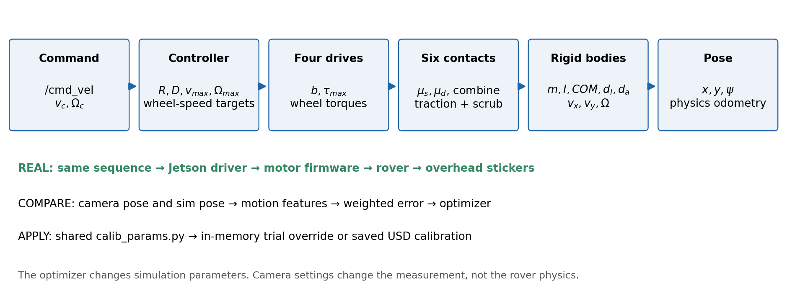
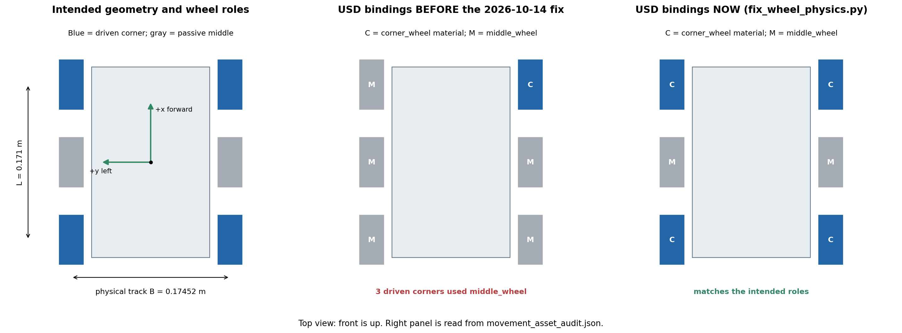
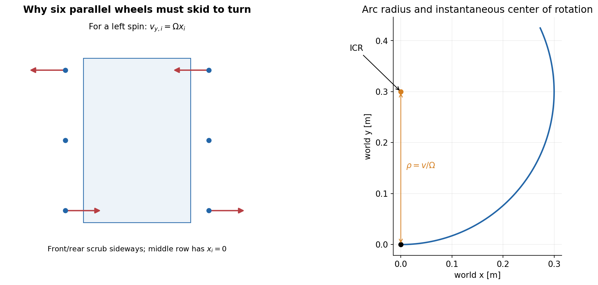
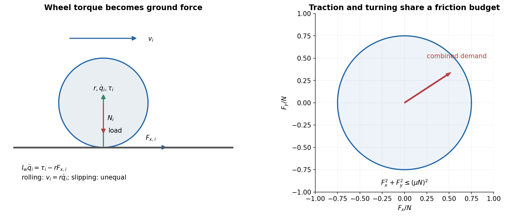
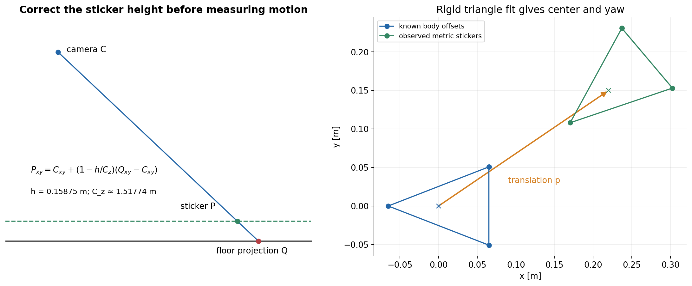

# Rover movement and sim-to-real calibration: code-grounded explanation

Audit date: 2026-10-14. This describes the current working tree, including uncommitted files. It is an explanation and static audit; no rover commands were sent. **Update (same day):** the wheel material bindings and wheel inertias described below as defects were repaired in `jetson_rover_v2.usd` by `ugv_controller_v2/tools/fix_wheel_physics.py`; see [PARAMETER_TEST_VALIDATION.md](PARAMETER_TEST_VALIDATION.md) for the Isaac before/after evidence and the per-parameter test map. The five accompanying diagrams are available as PNG, SVG and PDF in `movement_figures/`.

The active rover is a six-wheel skid-steer articulation. Its four corner wheels receive velocity targets. Its two middle wheels are passive revolute joints. No wheels steer about a vertical axis. Turning therefore requires sideways contact slip. The calibration system seeks simulation parameters that reproduce camera-measured real motion under the same command sequence.

## 1. What runs where

| Component | Source | Responsibility |
|---|---|---|
| Physical commands | `../parallel/cmd_sequence.py`, `../trials/trial_real.sh` | Run timed Twist steps locally on the Jetson over SSH; record overhead camera poses on desktop |
| Real base driver | `../../ugv_ws/src/ugv_main/ugv_bringup/ugv_bringup/ugv_driver.py` | Convert Twist into UART JSON for motor-controller firmware |
| Simulation asset | `../../jetson_rover_v2.usd` | Articulation, drive graph, contacts, mass properties and sensor graphs |
| Simulation runner | `../../ugv_controller_v2/common/run_baked_rover.py` | Open stage, add environment, apply trial calibration before play, step physics |
| Parameter authoring | `../../ugv_controller_v2/calibration/calib_params.py` | All 16 schema parameters and their USD destinations |
| Persistent calibration | `../../ugv_controller_v2/calibration/apply_sim_calibration.py` | Write calibration into USD, with backup |
| Camera measurement | `../calib/sticker_tracker.py`, `../trials/record_traj.py` | Pixel positions → metric sticker plane → chassis center and yaw |
| Trial backend | `../optimize/sim_eval.py` | Launch a fresh Isaac process for each candidate; command `/cmd_vel`, record `/ugv_sim/odom` using simulation timestamps |
| Fast approximation | `../optimize/forward_model.py` | Longitudinal/yaw reduced model for optimizer warm starts |
| Features and fitting | `../optimize/features.py`, `../optimize/calibrate.py` | Extract maneuver features and minimize variance-weighted errors |
| Live single-parameter fitting | `../optimize/calibrate_live.py` | Reuse a real reference and tune one parameter in Isaac, normally turning distance |
| Comparisons and visuals | `../trials/compare_paths.py`, `../demo/`, `../overhead/` | Start-aligned trajectory plots, demo orchestration and matching overhead views |

The baked simulation path is ROS Twist → scalar linear.x and angular.z → DifferentialController → left/right commands replicated to four corner joints → PhysX articulation. The default optimizer exercises this path. The explicit `mode="direct"` diagnostic bypasses ROS and sets corner-wheel speeds directly.

The older `ugv_controller/common/rover_drive_controller.py` uses a different Python control path and approximately 0.175 m separation. It is not the v2 baked graph. `rover_nav/calib/_deprecated/` contains the superseded runtime command scalers; its `linear_scale` and `angular_scale` are not current simulation physics parameters. `demo/dead_reckon.py` integrates ideal commands and is not measured real motion.

## 2. Coordinates, constants and actual asset state

Use body +x forward, +y left, +z up. Positive yaw ψ and yaw rate Ω turn left. Wheel rotation speed is q̇, distinct from Ω. World pose is (x,y,ψ); body velocity is (v_x,v_y,Ω).

| Quantity | Value / meaning |
|---|---|
| Physical wheel radius r | Approximately 0.04 m, from existing geometry audit; optimizer does not alter the mesh |
| Controller radius R | 0.04 m, independently read from DiffController |
| Physical track B | 2 × 0.08726 = 0.17452 m, from wheel joint anchors |
| Corner wheelbase L | 2 × 0.0855 = 0.171 m |
| Wheel longitudinal locations | x_i = −0.0855, 0, +0.0855 m |
| Wheel lateral locations | y_i = ±0.08726 m |
| Controller effective distance D | 0.5 m in the baked USD; this is not B |
| Base-link mass | 1.4049500 kg |
| Each wheel mass | 0.08 kg |
| Base + six-wheel mass | 1.88495 kg: the reduced model's mass approximation |
| Sum of explicit positive rigid-body masses resolved locally | Approximately 2.18998 kg, including sensor/arm bodies; not a measured hardware mass |
| Base principal inertia | (0.0065154224, 0.009339917, 0.012158603) kg m² |
| Base local center of mass | (−0.0004600878, approximately 0, −0.014795962) m |
| Base principal-axis quaternion | Approximately (0.9999944, 0, 0.00334826, 0); inertia axes are slightly rotated |
| Wheel principal inertias | Now (4.502e-5, 6.596e-5, 4.502e-5) kg m² = uniform hollow cylinder of the authored 0.08 kg. Before the fix: (1.1654e-4, 1.7074e-4, 1.1654e-4), the CAD inertia of a 0.2071 kg wheel left in place after the mass override, i.e. I_spin > m r² |
| Driven/passive counts | n_d=4, n_c=6 if all six actually carry ground load |
| Gravity | Approximately 9.81 m/s² downward |
| Runtime physics/render timestep | 1/240 s and 1/60 s; raw USD scene timestep is 60 Hz before runtime setup |
| Articulation solver | TGS; authored position/velocity iteration counts 32/4 |

**Material bindings before the fix differed from the intended groups** (now repaired: all four driven wheels resolve to `corner_wheel`, both passive wheels to `middle_wheel`). Pre-fix static USD material resolution gave:

| Wheel | Drive role | Resolved physics material |
|---|---|---|
| Front-left (`left_up`) | Driven | `middle_wheel` |
| Middle-left | Passive | `middle_wheel` |
| Rear-left (`left_down`) | Driven | `middle_wheel` |
| Front-right (`right_up`) | Driven | `corner_wheel` |
| Middle-right | Passive | `middle_wheel` |
| Rear-right (`right_down`) | Driven | `middle_wheel` |

Five collider prims explicitly bind `material:binding:physics` to the middle material. The front-right collider inherits a corner-material binding. Thus, before the fix, `middle_mu_*` changed three driven contacts as well as the two passive ones. `apply_to_stage()` writes material coefficients; it does not author bindings, so the repair was made in the USD itself.

The standalone USD reader could not resolve two remote camera/lidar references without Kit's asset resolver. Wheel joints, colliders, material bindings and the values above were locally readable. This audit does not establish the final PhysX-resolved mass of every remotely referenced body or runtime motion.

## 3. Every schema parameter

Defaults below are schema values. An override only takes effect if it is actually loaded. Unauthored rigid-body damping relies on simulator fallback until explicitly set. In the audited USD, the floor material is absent, wheel materials use `average`, and base linear/angular damping are not explicitly authored.

| Canonical key → YAML path | Default | Search range / status | Physical relationship |
|---|---:|---|---|
| `wheel_radius` → `differential_controller.wheelRadius` | 0.04 m | Frozen | Inverse wheel-speed conversion, equations (1–3); does not resize tires |
| `wheel_distance` → `differential_controller.wheelDistance` | 0.5 m | 0.25–0.9; stage 6 | Gain on differential wheel speed, equations (1,4); larger usually means faster yaw |
| `max_linear_speed` → `differential_controller.maxLinearSpeed` | 0.5 m/s | 0.2–0.8; stage 3 | Saturates commanded body speed before wheel conversion |
| `max_angular_speed` → `differential_controller.maxAngularSpeed` | 1.9 rad/s | 0.8–3; stage 3 | Saturates commanded yaw before conversion, not achieved yaw |
| `corner_mu_dynamic` → `wheel_friction.corner_wheel.dynamicFriction` | 1.0 | 0.5–1.5; stage 4 | Sliding friction on contacts actually bound to corner material |
| `corner_mu_static` → `wheel_friction.corner_wheel.staticFriction` | 1.2 | 0.5–1.8; stage 4 | Maximum no-slip tangential contact force on same material |
| `middle_mu_dynamic` → `wheel_friction.middle_wheel.dynamicFriction` | 0.65 | 0.3–1.2; stage 7 | Sliding friction on contacts actually bound to middle material |
| `middle_mu_static` → `wheel_friction.middle_wheel.staticFriction` | 0.8 | 0.3–1.4; stage 7 | Static contact bound on same material |
| `floor_mu_dynamic` → `floor_friction.dynamicFriction` | 0.75 | 0.3–1.1; stage 4 | Floor contribution to each sliding contact's combined friction |
| `floor_mu_static` → `floor_friction.staticFriction` | 0.85 | 0.3–1.3; stage 4 | Floor contribution to each static friction bound |
| `drive_damping` → `wheel_drive.damping` | 10000 | 50–20000, logarithmic; stage 2 | Velocity-error gain on each of four corner joints; equations (7–9) |
| `drive_max_force` → `wheel_drive.maxForce` | 3.4028235×10³⁸ | 0.3–50 N m, logarithmic; stage 2 | Per-wheel torque cap, including braking; enormous default effectively disables cap |
| `base_linear_damping` → `drag.base_linear_damping` | 0 s⁻¹ | 0–8; stage 5 | Base-link linear velocity decay / drag proxy; equations (12–15) |
| `base_angular_damping` → `drag.base_angular_damping` | 0.05 s⁻¹ | 0–8; stage 5 | Base-link angular velocity decay / yaw drag proxy |
| `base_mass` → `mass.base_link` | 1.40495 kg | Frozen | Base-link inertia in translation and its contribution to normal loads; not whole-rover mass |
| `wheel_mass` → `mass.wheel` | 0.08 kg each | Frozen | All six wheel masses: translation, normal loads, yaw inertia; does not explicitly rewrite authored wheel inertia |

There are **13 searchable parameters and 3 frozen parameters**. Physical track, wheelbase, center of mass and inertia are discussed in the modeling notes but are not input fields in this schema. The `--measure-geometry` prompt only covers the three frozen keys. Other physical constants must be maintained in assets and, where necessary, the reduced model's constants separately.

Additional settings outside this table matter:

- `friction_combine_mode`: minimum, average, multiply (PhysX also supports maximum). This is a contact-material rule, not another coefficient.
- Driven-joint `stiffness=0`, `type=force`: velocity feedback produces torque. Passive joints have drive damping, stiffness and maxForce all zero.
- Joint axes and local joint rotations determine the real axle directions. An authored joint `axis=Z` is in its rotated joint frame; it does not mean wheels spin about world vertical.
- Collision shape, contact offsets, rest offsets, solver iterations, timestep and load distribution affect contact behavior. They are not searched by this optimizer.
- The mesh update raised deck/sensor/arm mounts 45.7 mm while preserving wheel anchors. This changes transforms and mass distribution of moved parts; it did not supply new measured chassis mass properties.

## 4. Exact controller relationships

The following wheel conversion was checked against the installed C++ `OgnDifferentialController.cpp`, rather than inferred from field names.

First clamp the requested Twist:

$$\bar v=\operatorname{clip}(v_c,-v_{max},v_{max}),\qquad
\bar\Omega=\operatorname{clip}(\Omega_c,-\Omega_{max},\Omega_{max}).$$

Then compute left and right target wheel speeds:

$$\boxed{\dot q_L^*=\frac{\bar v-D\bar\Omega/2}{R},\qquad
\dot q_R^*=\frac{\bar v+D\bar\Omega/2}{R}.}\tag{1}$$

Both left corner joints receive the left target; both right corner joints receive the right target. These graph-level speeds are rad/s.

The node also supports acceleration, deceleration, angular acceleration and maximum wheel speed. They are not in the calibration schema and are not authored as active limits in the audited graph. Defaults of zero mean unset. If enabled, its discrete linear rate limiter is

$$v_k=\operatorname{clip}(\bar v_k,v_{k-1}-a\Delta t,v_{k-1}+a\Delta t),$$

with acceleration or deceleration selected by whether magnitude increases with the same sign. The C++ node requires **both** nonzero linear acceleration and deceleration to execute that limiter, and valid `dt`. The current `inputs:dt` has no connection. Angular limiting has the corresponding Ω update. Independent per-wheel clipping occurs after (1), so an active wheel-speed cap can change both speed and curvature.

For ideal two-sided rolling with physical radius r and physical track B:

$$\boxed{v_x=\frac r2(\dot q_R+\dot q_L),\qquad
\Omega=\frac rB(\dot q_R-\dot q_L).}\tag{2}$$

If targets are achieved and there is no longitudinal slip:

$$v_x=\frac rR\bar v,\qquad
\Omega_{ideal}=\frac rR\frac DB\bar\Omega.\tag{3}$$

For this six-wheel rover the second formula is a reference, not a no-slip turning solution. The multi-axle constraints below require lateral slip. The existing reduced kinematic description accounts for under-rotation with a lumped factor χ:

$$\boxed{\Omega\approx\frac rR\frac{D}{\chi B}\bar\Omega.}\tag{4}$$

χ is not a USD parameter and is not independently estimated by the current schema. It represents the net turning efficiency for a particular surface and operating regime. It need not stay constant over speed, loading, direction or arc curvature.

Consequences:

- Increasing R with fixed mesh r reduces commanded wheel speeds and generally reduces both linear and yaw motion. The YAML comment saying to raise R when real drives farther has the wrong sign.
- Increasing physical r at fixed R changes contact geometry and rolling gain; that is a different operation.
- Increasing D increases the wheel-speed difference. Under stable contact conditions it increases yaw; it does not spread the wheel mounts.
- With r=R and B=0.17452, D/B≈2.865. D is therefore a substantial turning-command amplification relative to physical two-wheel geometry.
- At v_c=0.15, Ω_c=0: both wheel targets are 3.75 rad/s. At v_c=0, Ω_c=0.6, D=0.5: targets are −3.75 and +3.75 rad/s. Achieved yaw still depends on torque and scrub.
- `maxAngularSpeed` clamps Ω_c before the D/B gain. It is not an absolute cap on the measured Ω. Reading a real achieved top yaw directly into this field is only valid after accounting for turning gain and contact behavior.

## 5. Full planar pose, arcs and wheel-contact velocities

The planar kinematic system including lateral skid is

$$\boxed{\begin{bmatrix}\dot x\\\dot y\\\dot\psi\end{bmatrix}
=\begin{bmatrix}\cos\psi&-\sin\psi&0\\\sin\psi&\cos\psi&0\\0&0&1\end{bmatrix}
\begin{bmatrix}v_x\\v_y\\\Omega\end{bmatrix}.}\tag{5}$$

The analytic model assumes v_y=0. Real and Isaac trajectories can have nonzero v_y during skid. For constant v_x=v, v_y=0, Ω≠0 over duration T, exact arc integration gives

$$x(T)=x_0+\frac v\Omega[\sin(\psi_0+\Omega T)-\sin\psi_0],$$
$$y(T)=y_0-\frac v\Omega[\cos(\psi_0+\Omega T)-\cos\psi_0],\qquad
\psi(T)=\psi_0+\Omega T.$$

As Ω→0, these reduce to straight translation. Signed radius and curvature are

$$\rho=v/\Omega,\qquad\kappa=\Omega/v,\qquad
\rho\approx\frac{\bar v}{\bar\Omega}\frac{\chi B}{D}.$$

The last expression assumes the same radius gain applies to both axes and negligible longitudinal slip. Different left/right slip breaks that cancellation.

For every wheel at body location (x_i,y_i), its center velocity is

$$\boxed{u_i=v_x-\Omega y_i,\qquad w_i=v_y+\Omega x_i.}\tag{6}$$

The longitudinal and lateral ground-relative contact slip velocities are approximately

$$\boldsymbol\nu_i=(u_i-r_i\dot q_i,\;w_i).$$

No-slip would require both components to vanish. During a centered spin v_y=0, front and rear rows have w_i=±ΩL/2, so all three rows cannot satisfy w_i=0 unless Ω=0. The front/rear wheels must scrub sideways in opposite directions. Their friction forces resist the turn.

The ideal middle row has x_i=0, hence zero lateral slip for a centered pure spin. It is incorrect to assume those wheels always dominate turning resistance solely because they are passive. They can affect loading, off-center ICR behavior, longitudinal rolling, asymmetry and finite-patch scrub. Before the binding repair, their named material also acted on three driven corners.

With body velocity (v_x,v_y) and Ω≠0, the instantaneous center of rotation in body coordinates is

$$x_{ICR}=-v_y/\Omega,\qquad y_{ICR}=v_x/\Omega.$$

For a point offset by a fixed body vector a from a reference center:

$$p_{point}=p_{ref}+\mathcal R(\psi)a,\qquad
\dot p_{point}=\dot p_{ref}+\Omega\mathcal R(\psi)J a,$$

where J rotates a vector by +90°. In a fixed-center spin its endpoint displacement is 2‖a‖|sin(Δψ/2)|, while its traveled arc length is ‖a‖|Δψ|. The feature `turn_walk` measures endpoint displacement, not arc length. A full turn can produce zero endpoint displacement despite a nonzero traced circle. COM offset can influence the dynamics but is not itself a prescribed ICR offset.

## 6. Motor / axle / wheel dynamics

With zero joint stiffness, the idealized force-drive equation in consistent radian units is

$$\boxed{\tau_i=\operatorname{clip}\{b_{SI}(\dot q_i^*-\dot q_i),-\tau_{max},+\tau_{max}\}.}\tag{7}$$

General PD drive adds k(q_i*−q_i); here k=0. PhysX solves drives implicitly with the articulation and contacts. Equation (7) is a physical interpretation, not an explicit simulation-step implementation.

**Unit distinction:** raw USD angular drive targets use degrees/second; articulation APIs and DifferentialController use radians/second. For a raw angular USD damping coefficient b_USD interpreted as torque per degree/second, b_SI=(180/π)b_USD. Do not insert the raw authored number into an SI formula without confirming the API conversion. The reduced Python model directly uses `drive_damping` as its lumped gain and omits that conversion. NVIDIA documents the conversion in [PhysicsDriveAPI](https://nvidia-omniverse.github.io/PhysX/ovphysx/latest/population/PhysicsDriveAPI.html).

Wheel torque balances tire reaction and wheel spin inertia:

$$I_{w,i}\ddot q_i=\tau_i-r_iF_{x,i}-\tau_{loss,i}.\tag{8}$$

Under straight no-slip motion, reflecting wheel spin inertia into translation gives

$$m_{eff}=m_{total}+\sum_i I_{w,i}/r_i^2,\quad
K_v=\sum_{i\in driven}b_{SI,i}/r_i^2.$$

For equal drives K_v=4b_SI/r². In the unsaturated linear regime, with viscous drag slope c and positive constant resistance F_0:

$$m_{eff}\dot v=K_v(v^*-v)-cv-F_0,$$
$$\boxed{v_{ss}=\frac{K_vv^*-F_0}{K_v+c},\qquad
\tau_v=\frac{m_{eff}}{K_v+c}.}\tag{9}$$

This explains damping: higher gain tracks the target more tightly and brakes harder at zero target. Lower gain can increase lag and load-dependent speed loss. At the very large configured gains, response is usually governed by timestep, available traction or torque saturation, rather than a realistic motor electrical time constant. The search range remains stiff, so it may not span the real ramp.

Torque and traction create competing force ceilings:

$$F_{torque}\le\sum_{driven}\tau_{max,i}/r_i,\qquad
F_{traction}\le\sum_{driven}\mu_iN_i,$$
$$a_{max}\approx\frac{\min(F_{torque},F_{traction})-F_{resistance}}{m_{eff}}.$$

Increasing torque cap helps only when motor torque is the active bottleneck. If contact grip is already limiting force, raising the cap mostly allows more wheel slip. In a spin, corner longitudinal forces supply a moment with lever arm approximately B/2.

A real DC motor and gearbox could be modeled as

$$L_a\dot i+R_ai=V-K_e\omega_m,\qquad
J_m\dot\omega_m=K_ti-\tau_{load}/G-b_m\omega_m,$$
$$\dot q=\omega_m/G,\qquad\tau_{wheel}\approx\eta_gG K_ti,$$

for reduction G=ω_m/q̇>1. The existing modeling note's wheel stall-torque expression divides by G; with that definition it should multiply by G, with gearbox efficiency η_g. The simulation schema contains no battery, current, voltage, winding resistance, gear efficiency, explicit controller latency or motor PID parameters. Its gain/cap are lumped proxies.

## 7. Static friction, sliding friction and floor combination

For a contact with normal load N_i, an isotropic static Coulomb approximation is

$$\sqrt{F_{x,i}^2+F_{y,i}^2}\le\mu_{s,i}N_i.$$

While sliding, an idealized dynamic law is

$$\mathbf F_{t,i}\approx-\mu_{d,i}N_i\frac{\boldsymbol\nu_i}{\|\boldsymbol\nu_i\|}.\tag{10}$$

PhysX uses discretized contact patches and solver approximations, so this is a governing contact model, not the complete solver algorithm. The key coupling is that sideways scrub and forward traction share the same tangential force budget. A scalar bound |F_x|≤μN alone misses this coupling.

Static friction is not inherently motor deadband. Ideal rolling traction uses static contact even when the rover is moving. Dynamic friction applies when the contact slips, not simply whenever the wheel is spinning. A rigid wheel with an unpowered free axle does not acquire a μN rolling drag force just because it rolls on a high-friction surface.

Wheel and floor material coefficients combine separately for static and dynamic friction:

$$\mu_{eff,i}=\begin{cases}
\min(\mu_{wheel,i},\mu_{floor})&\text{minimum}\\
(\mu_{wheel,i}+\mu_{floor})/2&\text{average}\\
\mu_{wheel,i}\mu_{floor}&\text{multiply}\\
\max(\mu_{wheel,i},\mu_{floor})&\text{maximum}.
\end{cases}\tag{11}$$

`min` makes the floor a clean knob only if the floor coefficient is lower than every relevant wheel coefficient. Otherwise the wheel caps the effective value. For example, the intended defaults with `min` give corner μ_d=0.75 and middle μ_d=0.65. With `average`, those become 0.875 and 0.70. The raw rover has no floor; these examples assume the stated floor override was actually bound at runtime.

When floor μ is below both wheel values under `min`, increasing wheel friction has zero local effect. Thus separately fitting floor and wheel friction from the same body trajectory can be mathematically unidentifiable. Dynamic and static coefficients also require maneuvers that actually distinguish sliding and sticking.

Normal forces are determined by all contacts and mass distribution, not automatically mg/6:

$$\sum_iN_i\approx mg,\qquad\sum_i x_iN_i\approx mgx_G,\qquad
\sum_i y_iN_i\approx mgy_G$$

in a level static approximation. Pitch/roll acceleration, COM height, irregular floors and contact geometry change these loads. The common driven-load approximation is N_driven≈(4/6)mg; it is not guaranteed for a rigid six-wheel platform.

## 8. Chassis dynamics, mass, inertia and drag

About the whole-rover COM, a rigid planar approximation is

$$\boxed{m(\dot v_x-\Omega v_y)=\sum_iF_{x,i}+F_{ext,x},}$$
$$\boxed{m(\dot v_y+\Omega v_x)=\sum_iF_{y,i}+F_{ext,y},}$$
$$\boxed{I_{zz}\dot\Omega=\sum_i(x_iF_{y,i}-y_iF_{x,i})+M_{ext,z}.}\tag{12}$$

Mass resists linear acceleration; yaw inertia resists angular acceleration. Both also affect stop behavior. Their effects depend on which force limit binds: in an ideal traction-limited acceleration μmg/m, mass cancels; in a torque-limited acceleration F_motor/m it does not. There is no universal rule that adding mass always reduces steady speed.

For component centers offset by a_j from the aggregate COM,

$$m=\sum_jm_j,\quad c=\frac{\sum_jm_jc_j}{m},$$
$$I_G=\sum_j\{\mathcal R_jI_{C,j}\mathcal R_j^T+m_j[(a_j^Ta_j)\mathbf1-a_ja_j^T]\}.$$

The reduced model approximates yaw inertia by base I_zz plus six wheel masses at B/2. It omits fore/aft wheel lever arms, accessory mass contributions and some wheel inertia contributions. The full articulation uses component properties and joint constraints. Explicitly editing mass does not itself supply revised measured diagonal inertias.

Chassis damping is a proxy for resistive surfaces. For the base body, the continuous interpretation is

$$\mathbf F_{d,b}\approx-m_bd_l\mathbf v_b,\qquad
\mathbf M_{d,b}\approx-d_aI_b\boldsymbol\omega_b.\tag{13}$$

These attributes are written to **base_link only**. Using total rover mass and inertia as coefficients is a reduced approximation. Their actual net wrench also depends on base-body velocity and its location relative to aggregate COM. Higher d_l bleeds translation; higher d_a bleeds rotation. A stiff unsaturated wheel drive may compensate by providing more torque, with little steady-speed change. Once torque/traction saturates, drag can lower achieved speed substantially.

True rolling resistance can be represented by F_rr=C_rrN, or a resisting wheel moment C_rrNr. Rigid Coulomb friction alone does not model carpet hysteresis, foam compression or sinkage. In `forward_model.py`, C_rr=0.015 is a hardcoded baseline, not a schema parameter and not a separately authored PhysX rolling-resistance model. No tire compliance, soil or suspension calibration is present in this pipeline.

### Commanding zero: braking rather than free coasting

Zero Twist means zero wheel-speed targets. The velocity servos remain enabled and brake. For positive v in a scalar approximation,

$$m_{eff}\dot v=-\min(K_vv,F_{brake,cap})-F_{rr}-cv.\tag{14}$$

The cap must respect both available motor braking torque and contact traction. Lower cap lengthens stopping distance only when that cap binds. With constant available braking/resistance F_B and viscous coefficient c, in the saturated regime:

$$v(t)=\left(v_0+F_B/c\right)e^{-ct/m_{eff}}-F_B/c,$$
$$t_{stop}=\frac{m_{eff}}c\ln(1+cv_0/F_B),$$
$$\boxed{d_{stop}=\frac{m_{eff}}c\left[v_0-\frac{F_B}c\ln(1+cv_0/F_B)\right].}\tag{15}$$

As c→0 these reduce to t_stop=m_eff v_0/F_B and d_stop=m_eff v_0²/(2F_B). The actual servo becomes unsaturated near zero, so (15) describes the constant-cap portion, not an exact complete stop under all conditions. The extractor declares stopped below 0.02 m/s.

## 9. What the analytic model implements and omits

`forward_model.py` actually uses

$$m=m_b+6m_w,\quad m_e=m+6I_w/r^2,\quad I_e=0.0122+6m_w(B/2)^2,$$
$$K_v=4b/r^2,\quad F_c=\min(4\tau_{max}/r,\mu_dmg\,4/6),$$
$$v^*=(r/R)\bar v,\quad\Omega^*=(r/R)(D/B)\eta\bar\Omega,\quad
\eta=1/(1+0.8\times0.75)=0.625,$$
$$m_e\dot v=\operatorname{clip}(K_v(v^*-v),\pm F_c)-C_{rr}mg\operatorname{sgn}(v)-md_lv,$$
$$I_e\dot\Omega=\operatorname{clip}(K_\Omega(\Omega^*-\Omega),\pm F_cB/2)
-\tfrac12C_{rr}mg(B/2)\operatorname{sgn}(\Omega)-I_ed_a\Omega,$$

where K_Ω=K_v(B/2)². It integrates with explicit Euler at dt=0.01 s and updates heading before position.

Its limitations are concrete:

1. Static friction coefficients are not used in its force law.
2. Middle-wheel friction coefficients are not used at all.
3. The scrub efficiency η is fixed at 0.625; it does not vary with fitted friction, despite broader prose suggesting μ-dependent skid efficiency.
4. There is no lateral velocity state. A symmetric pure spin has v=0 and `turn_walk=0` for every parameter value.
5. Yaw damping has no influence on a straight-only test with zero yaw command and zero initial yaw.
6. The raw USD drive-gain unit conversion, accessory masses, detailed wheel inertia, and (pre-fix) asymmetric material bindings are not reproduced.
7. At huge gain, explicit integration plus force clipping can generate numerical oscillation rather than the exact response of an implicit PhysX drive. It is a warm-start model, not a validation simulator.

Consequently, low analytic loss cannot establish realistic material coefficients or sim-to-real fidelity.

## 10. Camera equations and all movement-related measurement parameters

Camera calibration does not change physical motion, but it changes what the optimizer believes the rover did.

Pinhole projection is

$$\lambda[u,v,1]^T=K\mathcal R_{cw}(P-C),\qquad
K=\begin{bmatrix}f_x&0&c_x\\0&f_y&c_y\\0&0&1\end{bmatrix}.$$

The overhead renderer uses f_x=f_y=(W/2)/tan(FOV_h/2), with resolution 1280×720 and nominal horizontal FOV 70.4°. Camera position, look-at, up vector and grid origin determine projection and image orientation. `overhead/camera_setup.yaml` records an estimated optical center around (0.57787,−0.28132,1.47816) m and explicitly identifies nominal intrinsics.

The sticker configuration separately holds camera center approximately (0.499284,−0.040274,1.517744) m. These are different configurations used by different consumers; an image rendered with the former is not evidence the latter is correct.

`calib/calibrate_intrinsics.py` can fit K and rational lens distortion. For normalized image coordinates (a,b), ρ²=a²+b², the usual rational radial factor is

$$f_r=\frac{1+k_1\rho^2+k_2\rho^4+k_3\rho^6}{1+k_4\rho^2+k_5\rho^4+k_6\rho^6},$$
$$a_d=af_r+2p_1ab+p_2(\rho^2+2a^2),\qquad
b_d=bf_r+p_1(\rho^2+2b^2)+2p_2ab.$$

However, the active stream/grid/sticker recording path inspected here does not call undistortion or load `camera_intrinsics.yaml`. That YAML is not present in this working tree. Having an intrinsic-calibration script does not mean intrinsic correction is active.

The 1 m floor grid gives a pixel-to-metric homography:

$$\lambda[X,Y,1]^T=H_{img\to ground}[u,v,1]^T.$$

Divide by the third homogeneous coordinate. Four clicked corner correspondences determine H. A near-zero residual on those same four points is an interpolation result, not an independent accuracy measurement.

Stickers are above the floor. With sticker height h and optical center C, the pixel's ground-plane intersection Q must be corrected to

$$\boxed{P_{xy}=C_{xy}+(1-h/C_z)(Q_{xy}-C_{xy}).}\tag{16}$$

The tracker implements this affine transform composed with H. A dedicated `plane_H_img2m` can replace it. Current h=0.15875 m gives scale ≈0.8954. Ignoring height would enlarge horizontal separations by approximately 11.7% under this model, biasing speed, distance and triangle geometry.

Installed body-frame sticker positions are green (0.0650875,0.0508), orange-red (0.0650875,−0.0508), pink (−0.0650875,0) m (the rear sticker was yellow before 2026-11-18). The configured origin is the chassis center midway between middle-wheel hubs. The tracker estimates a proper rotation and translation, with no free scale:

$$\boxed{\min_{\mathcal R\in SO(2),p}\sum_{i=1}^3\|P_i-(p+\mathcal Rb_i)\|^2.}\tag{17}$$

For centered body/observed points, compute A=Σ(b_i−b̄)(P_i−P̄)^T=UΣV^T. Then

$$\mathcal R=V\operatorname{diag}(1,\det(VU^T))U^T,\quad
p=P̄-\mathcal Rb̄,\quad\psi=\operatorname{atan2}(\mathcal R_{21},\mathcal R_{11}).$$

Measured geometry makes p the configured chassis origin rather than triangle centroid. The old `rover_calib.json` rear-marker lever arm and marker-to-center offset are not applied by this tracker.

Detection parameters do not alter rover mechanics: sticker diameter 0.01905 m documents the physical dots; HSV ranges select the three colors; contour area 8–2500 px and circularity ≥0.45 filter blobs; up to 8 candidates/color are considered; edge discrepancy ≤0.015 m and rigid-fit RMS ≤0.006 m gate poses. Resolution must match 1280×720. Missing/invalid triangles produce no pose, rather than reusing stale poses. `geometry_measured` and `projection_verified` are both true in the current JSON, enabling precision recording by software policy; these flags are not independent experimental proof of metric accuracy.

## 11. Trajectory features, test sequences and optimization

CSV schema is t,x,y,yaw in seconds, metres and radians. From samples,

$$v_k\approx\frac{\sqrt{(\nabla x_k)^2+(\nabla y_k)^2}}{\nabla t_k},\qquad
\Omega_k\approx\frac{\nabla\operatorname{unwrap}(\psi_k)}{\nabla t_k}.$$

| Feature | Actual definition | Information supplied |
|---|---|---|
| `v_ss` | Median speed magnitude over final 40% of longest straight | Achieved steady speed |
| `dist` | Sum of point-to-point distances in that straight | Integrated motion; also sensitive to camera jitter |
| `tau_v` | Time to first reaching 0.632 v_ss; floor 0.001 s | Rise-time feature; a physical time constant only for a first-order response |
| `coast_time` | First following idle interval's time to speed ≤0.02 m/s | Commanded-stop response |
| `coast_dist` | Path length in associated stopping window | Momentum, braking, traction and drag |
| `omega_ss` | Median absolute yaw rate in final 40% of longest spin | Effective turning gain and load limits |
| `dyaw` | Absolute unwrapped end-to-start yaw over spin | Turning gain plus startup and timing effects |
| `tau_omega` | Time to first reaching 0.632 omega_ss | Rotational rise feature |
| `turn_walk` | Spin endpoint displacement magnitude | Drift/reference offset/asymmetry; does not measure total wandering |
| `arc_radius` | Median speed / median absolute yaw rate in first arc | Relative linear-to-yaw response |

The current test files prescribe:

| Test | Motion portion | Nominal ideal motion | Main relationships |
|---|---|---|---|
| T1 straight | 0.15 m/s for 4 s, then 3 s stop | 0.6 m before stop | R/r, drive gain/cap, grip and linear drag |
| T2 spin | 0.6 rad/s for 8 s, then 2 s stop | 4.8 rad commanded angle | D, scrub, yaw inertia and yaw drive/drag |
| T3 sweep | 0.05,0.10,0.15,0.20 m/s, each 1.2 s | 0.6 m total | Command-response slope and resistance; current range does not reach default 0.5 m/s cap |
| T4 arc | 0.12 m/s and 0.4 rad/s for 6 s | Commanded radius 0.3 m | Linear-to-yaw gain and simultaneous contact demand |
| T5 stop | 0.20 m/s for 3 s, then 4 s stop | 0.6 m before braking | Brake cap, grip, linear drag and inertia |

These nominal values describe requested Twist integration, not guaranteed measured motion. In particular, 0.6×8=4.8 rad is 275°, not a full 360° turn.

The staged fitter currently does:

| Stage | Parameters | Scored test and features | Identification caveat |
|---|---|---|---|
| 2 drivetrain | b, τ_max | T1: tau_v, coast distance/time | If grip rather than torque limits force, τ_max has weak effect |
| 3 clamps | v_max, Ω_max | Read directly from `top_speed`, else T3 features | Achieved speed is not automatically the correct command clamp |
| 4 friction | Corner and floor static/dynamic μ | T3: distance, steady speed, rise and coast | `min` creates flat directions; static μ unused analytically |
| 5 drag | d_l,d_a | T1: steady speed and coast | Straight-only analytic test cannot constrain d_a |
| 6 turning | D | T2: yaw change and steady yaw | Startup latency can bias total angle; D can absorb wrong friction |
| 7 turn walk | Middle static/dynamic μ | T2: endpoint translation | Analytic model predicts zero walk and ignores both parameters |

T4 arc, T5 dedicated stop and the extracted rotational rise time are not explicitly included as independent scored stages. `features.extract()` takes only the longest straight segment, not a separate response for every T3 speed step; it does not automatically fit a full saturation curve. `build_targets.py` can compute a 95th-percentile speed but that still requires a test which genuinely excites top speed. Its current straight-only sweep cannot measure angular top speed.

For features f_j and real repeat statistics (mean_j,σ_j), the loss is

$$\boxed{L(\theta)=\sum_{j\in scored}\left(\frac{f_j^{sim}(\theta)-\bar f_j^{real}}{\max(\sigma_j,10^{-6})}\right)^2.}\tag{18}$$

Missing/nonfinite features receive a penalty of 25. Repeated targets use sample standard deviations, floored at max(0.02|mean|,0.001). The numerical floor is reused across feature types, so its physical unit follows the feature. A single trial's floor is a heuristic weight, not measured repeatability.

One-dimensional warm starts use bounded scalar minimization; coupled stages use differential evolution. Isaac refinement uses bounded-through-clipping Nelder–Mead. The stages update parameters sequentially. They do not guarantee globally unique physical coefficients. The loss is a sum, not an average: near-noise residuals do not imply a universal loss of 1; its statistical expectation depends on the number of independent scored features and fitted degrees of freedom.

The sensitivity matrix J_jk=∂f_j/∂θ_k must have enough independent columns for local identification. Flat or collinear columns mean more measurements or fixed parameters are needed. A good trajectory fit can coexist with incorrect individual parameters.

## 12. Timing, real-driver behavior, application and evidence

The real driver makes small pure-spin commands nonlinear: if v_c=0 and 0<|Ω_c|<0.2, it sends Ω=0.2 sign(Ω_c). Otherwise it forwards the selected values in UART JSON `{T:'13', X:v, Z:Ω}`. The motor firmware is outside the inspected implementation; its full PID, gearing and low-speed logic are not established here. The v2 simulation controller does not implement this minimum-spin rule. A single D cannot match both sides of that nonlinear threshold.

Navigation can add limits upstream of this plant. For example, `ugv_ws/src/ugv_main/ugv_nav/params/rpp.yaml` requests 0.3 m/s in its path follower, but its velocity smoother is configured for a 0.26 m/s linear cap, 0.5 rad/s angular cap, linear acceleration/deceleration magnitudes 0.4 m/s², and angular acceleration/deceleration magnitudes 0.6/1.0 rad/s². The smoother runs at 20 Hz with open-loop feedback and a 1 s command timeout; a collision monitor can further change the final `/cmd_vel`. These are command-generation settings, separate from the simulation schema. A calibration publishing directly to `/cmd_vel` does not automatically exercise those upstream limits. For navigation replay, record the final command after smoothing and collision monitoring.

The real odometry source computes Δs=(Δs_R+Δs_L)/2 and Δψ=(Δs_R−Δs_L)/0.175, with heading optionally taken from IMU. Encoder odometry therefore already assumes a differential geometry and cannot independently establish true skid motion. This is why an overhead pose is valuable.

The current native Isaac backend uses message header simulation timestamps to schedule commands and write trajectory time. A slow renderer therefore does not shorten a maneuver. The generic `record_traj.py --source odom` still stamps reception wall time; that recorder is not interchangeable for rate measurements in a slow-running simulation. Camera frames use receiver timestamps rather than a demonstrated shared exposure-time clock. `build_targets.py` removes onset delay by thresholding sustained motion; this can also remove some physical breakaway delay. Position start alignment alone does not fix time alignment.

`demo/realtime_demo.py` is a separate live workflow: its sequence is scheduled by wall time, and its loop writes the latest sim pose and camera detection with loop elapsed time without deduplicating odometry stamps or camera frame IDs. Its sample counts therefore do not necessarily represent distinct sensor observations. The sequential camera recorder does deduplicate frames, and the native optimizer backend requires advancing simulation stamps. Use the latter paths for precision feature identification; treat live-demo results with the relevant timing and provenance limits.

`compare_paths.py` rotates and translates each trajectory into its first-pose frame:

$$\tilde p(t)=\mathcal R(-\psi_0)[p(t)-p(0)],\qquad\tilde\psi(t)=\psi(t)-\psi_0.$$

It interpolates positions onto a common time grid and reports Euclidean errors, path lengths and wrapped final heading difference. Endpoint comparisons use each full trajectory's endpoint even if durations differ. Compare corresponding times and physical reference points deliberately.

Application details that change what is actually simulated:

- Baked values, schema defaults, a surface output and the runtime override are different states. The saved `surfaces/live.yaml` does not automatically replace the USD's D=0.5.
- A surface result contains nested `sim_calibration_yaml`. Runtime `flatten()` expects the calibration blocks at the top level; extract that block before passing the file to the runner. Passing the wrapper surface file directly does not load its inner values.
- Runtime combine mode is a separate argument. `_apply_calibration()` does not read `friction_combine_mode` from the supplied YAML. Pass `--combine-mode` explicitly.
- Floor material must exist and be bound in the environment. The runtime path creates/binds it when floor settings or combine mode request it. A rover-only bake normally excludes floor authoring.
- In the bake path, combine-mode updates are performed inside `author_floor()`. With floor authoring disabled, the convenience YAML combine key does not update wheel combine attributes either.
- Damping attributes are runtime authorable before play; DifferentialController caches inputs on initialization, supporting the fresh-process/pre-play application strategy.

The saved live single-parameter result reports D from 0.5 to 0.3036257, sim steady yaw from 0.5731307 to 0.2066610 rad/s against real 0.1852777 rad/s. The absolute steady-rate error drops from about 0.38785 to 0.02138 rad/s, approximately 94.5% less, but the final rate remains about 11.5% high. This is evidence for that saved spin fit, not whole-system calibration. Historical tracking configurations and timestamps must be checked before treating old CSVs as current chassis-center ground truth.

The `heavy_carpet.yaml` surface result contains fitted numbers but does not record enough backend/provenance information to establish that every value is a validated real-to-Isaac physical estimate. Its reference target file is explicitly an example. Preserve that distinction when reporting outcomes.

## 13. Practical interpretation of parameter changes

| Symptom | Relationship to inspect first |
|---|---|
| Straight distance wrong at modest command | Ground-truth metric scale, time alignment, physical r versus R, achieved wheel speed and longitudinal slip |
| Wheel speeds correct but body moves less | Contact slip / insufficient traction; verify actual material bindings and normal loads |
| Acceleration too abrupt | Whether torque or traction binds; commanded acceleration limit if deliberately introduced; huge b alone is not a realistic motor model |
| Zero-command stop too abrupt | Active servo brake cap and traction, not free-coast damping alone |
| Steady spin too fast | D, current asymmetric contact assignments and scrub; measure after onset |
| Arc radius wrong despite good straight speed | Relative yaw gain, simultaneous traction/scrub and any wheel-speed clipping |
| In-place spin drifts | Actual material symmetry, normal loads, reference-point offset, ICR and lateral motion |
| Carpet speed deficit with little wheel slip | Torque/drag or surface-dependent motor response; lowering μ alone creates a different physical mechanism |
| Optimizer returns different coefficients with the same path | Unidentifiable or weakly excited parameters, heuristic model limitations, or measurement noise |

The primary audit finding to resolve before interpreting physical friction estimates is the actual wheel-material mapping. Then verify the camera scale/reference and shared test timing, separate linear and yaw excitation, and validate fitted dynamics in Isaac with held-out arcs and stops.

## Sources

Repository sources are named in the system table and each implementation is identified in context. The machine-readable [static USD audit](movement_asset_audit.json) records all parameter destinations and resolved wheel-material bindings; [audit_movement_asset.py](audit_movement_asset.py) reproduces it with Isaac's standalone USD Python libraries. The pre-existing `MODELING.md`, `PARAMETER_MAP.md` and `figures.tex` provide useful background but include the discrepancies identified above. Installed controller implementation: `/home/joshroq/Applications/isaacsim/exts/isaacsim.robot.wheeled_robots.nodes/isaacsim/robot/wheeled_robots/nodes/ogn/nodes/OgnDifferentialController.cpp`. The installed experimental articulation API also explicitly converts angular drive damping between degree-based USD gains and radian-based runtime gains.

External primary documentation used to check drive semantics: [NVIDIA PhysicsDriveAPI](https://nvidia-omniverse.github.io/PhysX/ovphysx/latest/population/PhysicsDriveAPI.html), [NVIDIA PhysX joints](https://nvidia-omniverse.github.io/PhysX/physx/5.4.0/docs/Joints.html), and [NVIDIA articulation stability guide](https://docs.omniverse.nvidia.com/kit/docs/omni_physics/110.0/dev_guide/guides/articulation_stability_guide.html). The symbolic planar/contact equations are explanatory physical reductions; they are explicitly distinguished from the complete numerical PhysX contact/articulation solver.
